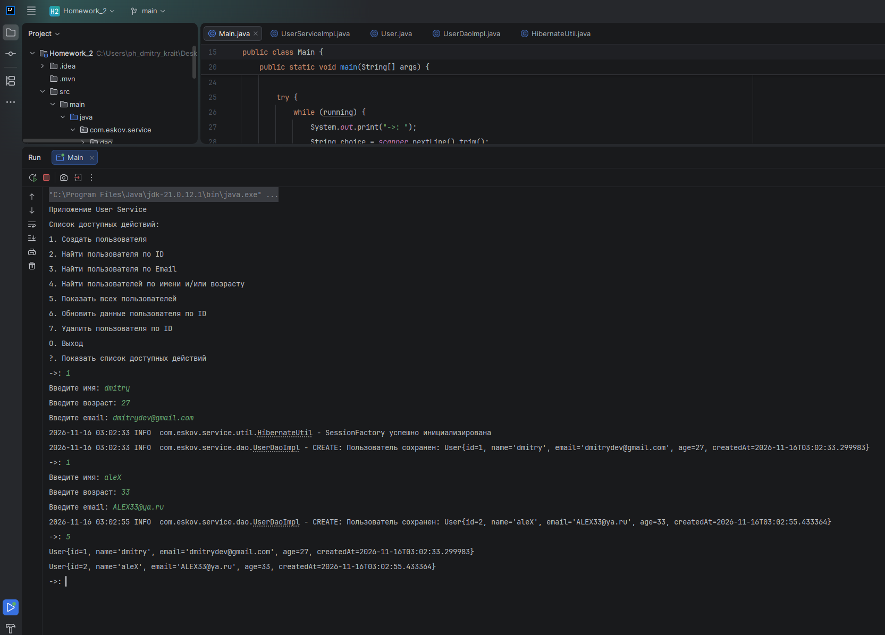
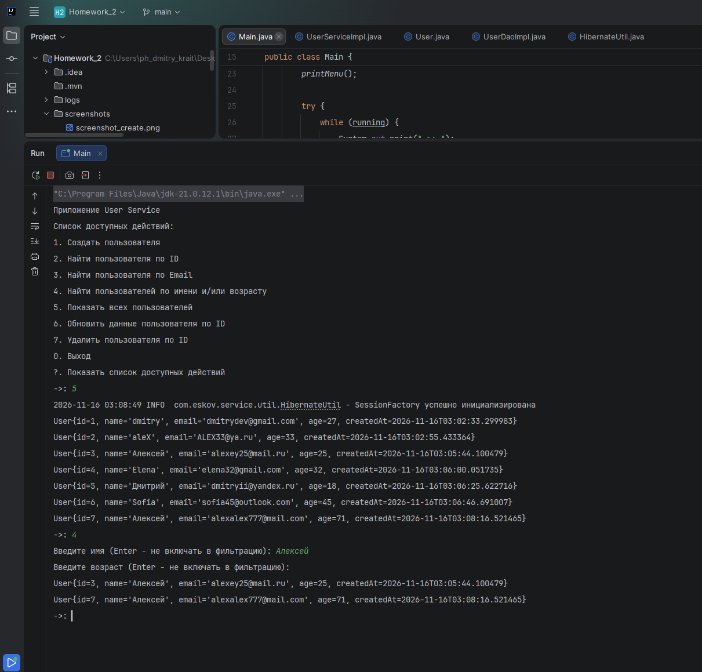
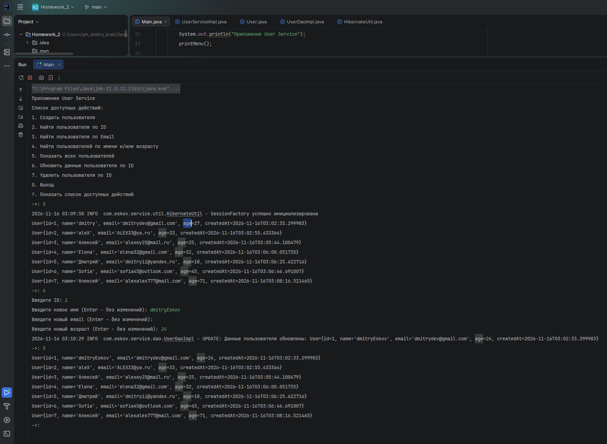
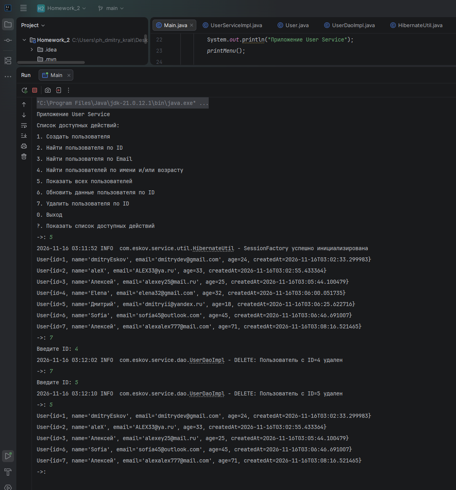
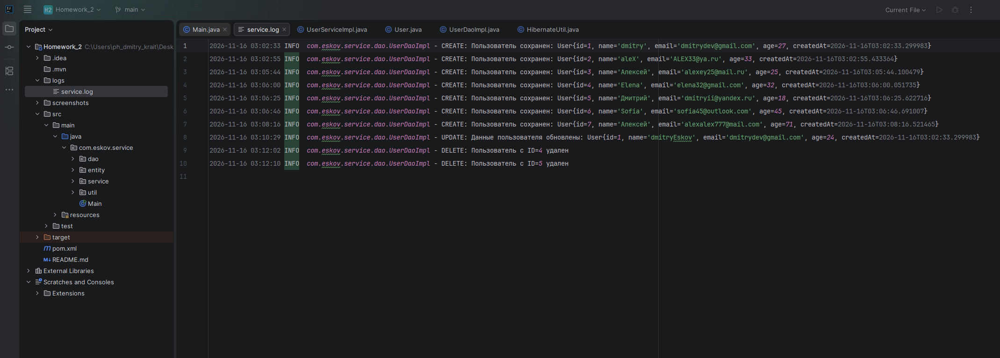

# Домашнее задание №2
## Реализация консольного приложения User Service

## Используется Hibernate для взаимодействия с PostgreSQL
## Поддерживаются базовые операции CRUD над сущностью User(id, name, email, age, created_at)
## Используется Maven для управления зависимостями
## Используется SLF4J + Logback для логирования 

### Результат работы программы:

### Добавление пользователей:

### Поиск пользователей по фильтрам:

### Обновление данных пользователей:

### Удаление пользователей:

### Логи работы

